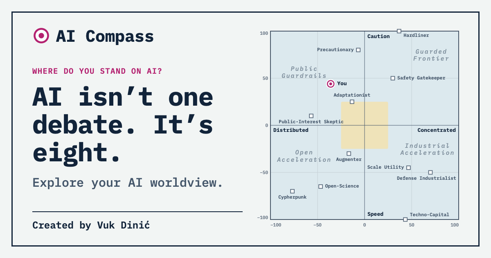
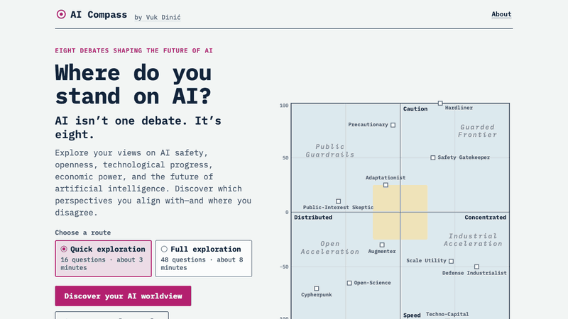
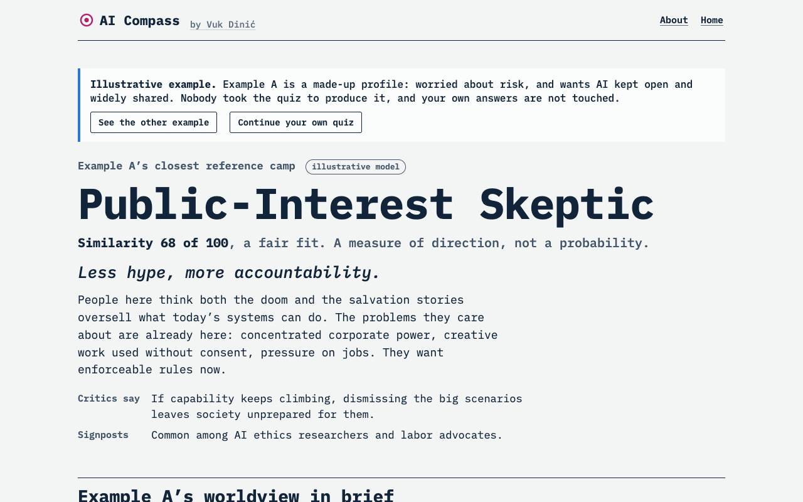
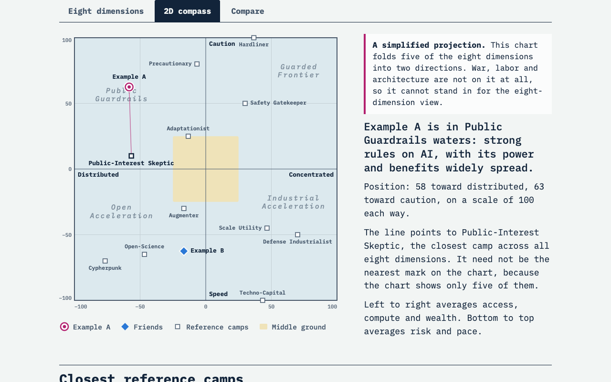
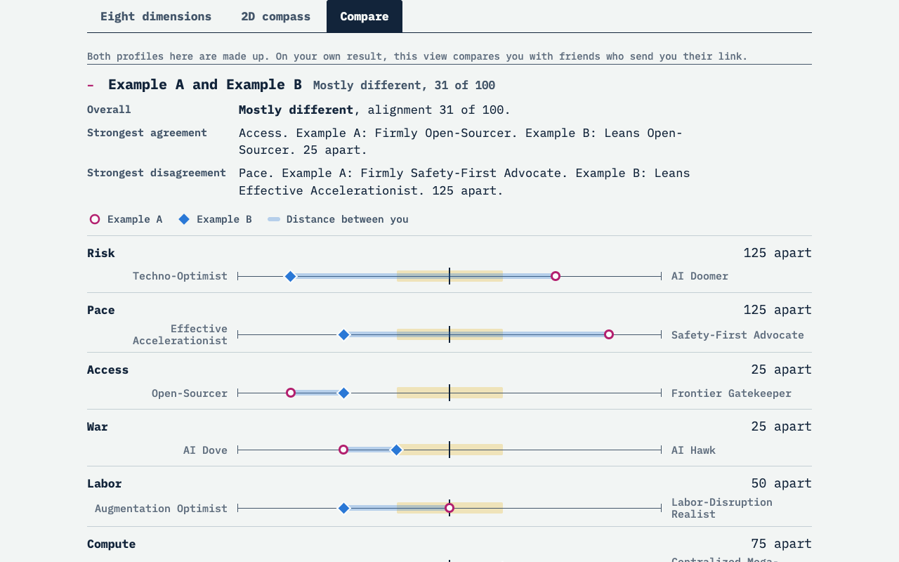

# AI Compass

**Eight debates shaping the future of AI.** By [Vuk Dinić](https://vukdinic.com/).

> AI isn't one debate. It's eight.

[](https://compass.vukdinic.com/)

**[Open the live app →](https://compass.vukdinic.com/)** · [Project page](https://vukdinic.com/projects/ai-compass/) · [See an example result](https://compass.vukdinic.com/#demo)

## The problem

Arguments about AI are usually drawn as one line, from optimists to doomers. That line hides most of the disagreement. A person can think advanced AI is dangerous and still want it open. Another can be relaxed about risk and still want strict rules about who profits. Two people who agree on one question often disagree on the next.

AI Compass separates eight of those questions. You rate a set of statements, and it shows where you stand on each question, which positions you hold most firmly, and where you differ from a friend.

It is an exploratory educational tool, **not a scientifically validated psychological or political test**.

## Demo



A [higher-quality video](launch-assets/demo.mp4) and a [still frame](launch-assets/demo-poster.png) are in `launch-assets/`. The recording is of the real app, using its built-in example profile, and can be re-made with `node tools/capture.mjs video`.

| Eight dimensions | 2D compass | Comparing two people |
|---|---|---|
|  |  |  |

## Features

- **Quick or full.** 16 statements for a provisional result in about three minutes, or 48 for the full one in about eight. You can continue from 16 to 48 without losing an answer.
- **Eight dimensions first.** Every dimension is shown with both poles, the middle ground, your position, a worded score and the answers behind it. A dimension you did not answer is shown as "not scored", never as neutral.
- **A 2D compass**, labelled as what it is: a projection of five of the eight dimensions.
- **A worldview summary** written by fixed rules: your firmest position, your most balanced one, the pairing of views that the fewest reference camps share, and the closest camp.
- **Transparent reference camps.** The three closest of eleven illustrative camps, with the dimensions where you sit on the same side and on opposite sides, and a plain explanation of the similarity number.
- **Comparison with friends.** Side-by-side positions on all eight dimensions, the smallest and largest differences, and a question or two worth discussing. Sharing is by link or code, with no server.
- **Result images.** 1080×1080 and 1080×1350 PNGs drawn in the browser, plus a text summary to copy and the device's share sheet where there is one.
- **Example mode.** Two made-up profiles, clearly labelled, for teaching, screenshots and presentations (`#demo`, `#demo-2`).
- **Private by construction.** No account, no analytics, no cookies, no backend. Answers live in the browser's local storage.
- **Accessible and calm.** Keyboard operable, screen-reader labels on charts, light and dark themes, and no motion for visitors who ask for reduced motion.

## The eight dimensions

| | Question | From | To |
|---|---|---|---|
| **Risk** | What are we building, and can something smarter than us be controlled? | Techno-Optimist | AI Doomer |
| **Pace** | How fast should the most capable AI be built and released, relative to the rules around it? | Effective Accelerationist | Safety-First Advocate |
| **Access** | Who gets access to the most capable models and the recipes for training them? | Open-Sourcer | Frontier Gatekeeper |
| **War** | How should AI change military power, deterrence and the use of force? | AI Dove | AI Hawk |
| **Labor** | Does AI mostly make human workers more capable, or replace thinking work altogether? | Augmentation Optimist | Labor-Disruption Realist |
| **Compute** | Where does intelligence physically live: on many small devices, or in a few giant data centers? | Distributed and Edge | Centralized Mega-Cluster |
| **Architecture** | Does general intelligence emerge from scale alone, or does it need new, engineered designs? | World-Model Architect | Scaling Maximalist |
| **Wealth** | When thinking work no longer needs human time, who owns what it produces? | Compute and Data Redistribution | Capital-Compute Capture |

## How the quiz works

1. Choose the quick route (16 statements) or the full one (48).
2. Rate each statement from *strongly disagree* to *strongly agree*, or skip it. Every statement has a short note explaining its terms. Answers are saved in your browser as you go, and you can go back and change them.
3. Read the result: a headline, a summary, the eight dimensions, the 2D compass, and the closest reference camps.
4. Optionally send a friend your comparison link, or save the result as an image.

Statements come in rounds of eight, one per dimension, alternating between poles. After two rounds every dimension has one statement from each pole, which is why the quick route stops at 16.

## Scoring and matching

**Dimensions.** Each dimension has six statements: three written from one pole and three from the other. A dimension's score is your average agreement with the high-pole statements minus your average agreement with the low-pole statements, scaled to the range −100 to +100. Because the statements are balanced, agreeing with everything scores 0.

**Skipped is not neutral.** Skipped and unanswered statements are left out of the averages. *Neutral* is an answer and counts as the midpoint.

**Mixed answers.** Agreeing with both poles gives a score near 0 and a "pulled both ways" flag; rejecting both gives "neither pole fits". Scores within 25 of the center count as the dimension's named middle ground.

**2D compass.** Left to right is the mean of access, compute and wealth. Bottom to top is the mean of risk and pace. War, labor and architecture are not on the chart.

**Reference camps.** Eleven hand-written profiles on the eight dimensions. Similarity is the cosine similarity between your scores and a camp's profile over the dimensions you have a score for. It measures direction and ignores strength, and it is not a probability of membership. A camp is named only when similarity is at least 0.45, at least five dimensions are scored, and the profile is not nearly flat.

**Comparing two people.** Alignment is 100 minus the mean absolute gap between two people's scores over the dimensions both have, and 0 once that mean reaches 100.

**Summary.** Fixed rules over the scores, in `summarize()` and `summaryLines()` in `js/core.js`. No language model is involved.

The same explanation, for visitors, is on the app's [About page](https://compass.vukdinic.com/#about). Details for developers are in [docs/ARCHITECTURE.md](docs/ARCHITECTURE.md).

## Architecture

Plain HTML, CSS and JavaScript. No framework, no build step, no dependencies, no backend.

```
index.html        static page: metadata, structured data, the landing copy and the full About text
css/compass.css   all styles; motion sits behind prefers-reduced-motion
js/core.js        content and pure logic: dimensions, statements, camps, scoring, share codes, summaries
js/ui.js          DOM helpers, saved state, the compass chart, page frame, router
js/quiz.js        landing page and quiz
js/result.js      result page: summary, three views, reference camps
js/compare.js     comparing with friends
js/card.js        result images and sharing
compass.test.js   unit tests for js/core.js and checks on index.html (node --test)
tools/            headless-Chrome driver, browser tests, and the screenshot / preview / video generator
assets/           icons and the link-preview image
launch-assets/    screenshots, example graphics, demo video and announcement drafts
docs/             architecture, testing and deployment notes
```

`index.html` is readable without JavaScript: search engines, link previews and visitors with scripts off get the description, the eight dimensions, the methodology and the privacy text. The app replaces the page on load and reuses the same About text.

## Running it locally

There is nothing to install. Serve the folder with any static server:

```bash
python3 -m http.server 8000
```

Then open <http://localhost:8000/>. Opening `index.html` directly from disk also works, except that comparison links are not offered there.

Tests need Node 18 or newer. The browser tests and the capture tool need Node 22 or newer and Chrome.

```bash
node --test
```

```bash
node tools/e2e.mjs
```

```bash
node tools/capture.mjs preview
```

`capture.mjs` also takes `shots` (screenshots and example graphics) and `video` (the demo recording, needs ffmpeg). See [docs/TESTING.md](docs/TESTING.md).

## Deployment

The site is the repository itself, served by GitHub Pages from the `main` branch root. Pushing to `main` deploys. The steps for moving to the custom domain `compass.vukdinic.com`, including the DNS record and what happens to old links and saved answers, are in [docs/DEPLOYMENT.md](docs/DEPLOYMENT.md).

## Privacy

- No account, analytics, cookies or server-side storage.
- Answers, your optional name and friends' codes are stored in the browser's local storage under `ai-compass-v2`, and can be erased from the About page.
- A share code (`AIC2-…`) contains every answer. It travels only when you send it. In a comparison link it sits after the `#`, which browsers do not send to the server.
- Result images and text summaries contain no individual answers.
- The only third-party request is for the IBM Plex Mono typeface from Google Fonts. GitHub Pages hosts the files.

## Limitations

- **Not validated.** No reliability or validity studies have been run. Results describe answers to these statements, not a stable trait.
- **One author's reading.** The dimensions, statements and camps reflect one person's interpretation of the debate.
- **Camps are illustrations.** They were not derived from data. Public figures named beside some camps are signposts based on their public arguments; none of them took the quiz or endorsed a profile.
- **Quick results are coarse.** Two statements per dimension give scores in steps of 25, and the closest camp can change with more answers.
- **English only**, and written from within a mostly Western, English-language debate.

## Inspiration and attribution

The starting point was Kristin Houser's article [“10 perspectives that divide the AI world”](https://bigthinkmedia.substack.com/p/10-perspectives-that-divide-the-ai) for Big Think, which sorts the debate into ten tribes. AI Compass is an independent interpretation inspired by that article: it reworks the tribes into eight independent dimensions and adds its own statements, scoring and reference camps. It is not affiliated with or endorsed by the author or Big Think.

The typeface is [IBM Plex Mono](https://github.com/IBM/plex) (SIL Open Font License).

## Creator

Vuk Dinić is a computational sociologist and data scientist working at the intersection of artificial intelligence, social science, and technology's impact on society. His work explores how computational methods can help us understand language, political participation, and emerging technologies.

[vukdinic.com](https://vukdinic.com/) · [GitHub](https://github.com/realvuk) · [LinkedIn](https://www.linkedin.com/in/vukdinic/) · <vuk.dinic@ijs.si>

## Feedback and contributions

- [Suggest an improvement](https://github.com/realvuk/ai-compass/issues/new?template=improvement.yml)
- [Report a problem](https://github.com/realvuk/ai-compass/issues/new?template=bug.yml)
- [Question the wording of a statement](https://github.com/realvuk/ai-compass/issues/new?template=wording.yml)
- [Raise a methodological concern](https://github.com/realvuk/ai-compass/issues/new?template=methodology.yml)

You never need to share your answers or your result code to give feedback. See [CONTRIBUTING.md](CONTRIBUTING.md) before opening a pull request.

## License

This repository does not contain a license file yet. Until the author adds one, the code and content are not licensed for reuse: you may read the source and use the app, but copying, modifying or redistributing it needs the author's permission. If you would like to reuse something, please [open an issue](https://github.com/realvuk/ai-compass/issues/new).
